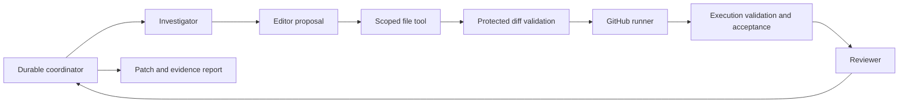

# Architecture

The lab controls an independent target repository. Agents receive serialized evidence and have no shell or filesystem access. The Editor returns a file proposal; `ScopedFiles` alone applies it. Its exact allowlist is `ci/plan.json`. The strict plan contains a cache flag and an explicit partition of the protected test inventory. It cannot express commands, test filters, secrets, dependencies, workflow expressions, or arbitrary scripts.

`src/contracts` owns strict v1 Zod contracts. `src/coordinator` owns lifecycle transitions, cycles, cancellation, dependency injection, and final outcomes. `src/adapters/records` owns atomic writes, digest verification, locks, concurrency, and the cumulative budget. Model and GitHub adapters receive explicit dependencies. They do not read arbitrary credentials or choose replacement providers.

A run pins the manifest and target commit, validates the baseline, and creates disposable Git worktrees beneath the run directory. The baseline and each candidate have independent indexes. Failed candidates never modify the target's main checkout or become the next baseline. Only the controller publishes `lab/<run-id>/...` branches; no merge or deployment occurs.

Artifacts are immutable content-addressed JSON. Their envelopes include schema version, run, step, attempt, inputs, and outputs. References bind evidence to commits and patch digests. The state file points to verified artifacts; numbered event snapshots preserve each committed transition. A completed block reuses its artifact. A completed model call reuses its response receipt. Cached observations bind the complete dispatch request, frozen manifest, CI plan, and observation digests. Legacy receipts require the saved manifest, matching durable intent, and fresh protected execution validation before a separate binding record is added; original observations remain unchanged. A submitted workflow reconciles its exact correlation, branch, and commit before any further action.

## Trust boundary

Protected manifests live in the lab and include every target file digest, expected output digest, required test, allowed file, runner, and command. The runner downloads reports emitted by protected execution code. Validation checks actual test inventory, duplicates, partition assignments, known outputs, run identity, plan digest, cache conditions, attempts, and every job conclusion. A green badge alone cannot pass.

The model has no path to manifests, acceptance code, credentials, the lab filesystem, or evaluation answer keys. OpenCode runs in an empty temporary home and working directory, with a private server, a sanitized environment, project config disabled, and all tools denied. HTTP models receive only serialized context and no tools. Scoped writes reject traversal, absolute paths, symlinks, hard links, protected files, and extra plan fields.

This boundary relies on trusted controller and fixture code. It does not sandbox an arbitrary third-party workflow against every possible attack. The narrow declarative edit surface trades generality for independently checkable behavior.
